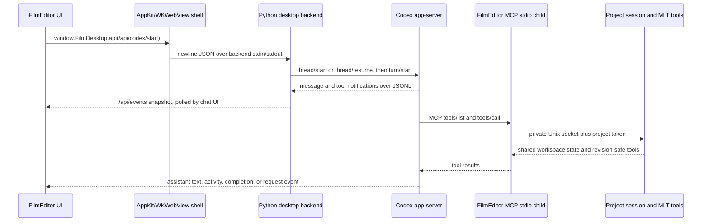

# FilmEditor AI provider and workspace handoff

Reviewed against the FilmEditor source and the official Codex App Server, Claude Agent SDK, and Model Context Protocol documentation on 2026-10-08. This is an implementation handoff and a design note for a possible future Claude provider. It does not claim Claude support is implemented.

## Current implementation status

FilmEditor currently has one AI provider: the `Codex` class in [`film/codex.py`](../film/codex.py), which starts the installed Codex CLI in `app-server` mode and uses the user's existing ChatGPT sign-in. There is no Claude provider, provider selector, Anthropic authentication flow, Claude Agent SDK dependency, or shared multi-provider conversation schema. Do not set Claude as a project provider or tell users that an Anthropic account can use their Codex/ChatGPT authentication.

The provider-independent boundary already exists below the model session: FilmEditor exposes its project and engine tools through MCP over stdio. Codex starts that MCP client as a child process; that child reaches the open native app over the current project's private Unix socket. A future agent host can call the same MCP tools if it can launch the stdio adapter, but provider auth, session state, permissions, streamed events, and user-visible model selection still need a dedicated adapter.

`web/assistant.js` adds an AI edit/render brief and a local media-detection flow. Both AI prompts use `/api/codex/start` and inherit the project's selected permission mode. On import, the UI calls `film_configure_from_media` with the active sequence path and current revision. Local FFprobe metadata can configure a supported empty automatic sequence once; existing edits and explicit settings remain untouched. `film_detect_media` returns allowlisted stream facts, a deterministic reference-group recommendation, and reasons for unresolved or unsupported signal data. It does not guess a camera Log identity, LUT, or verified color conversion. The import-only setup turn is limited to unresolved technical decisions; it cannot invent a creative brief or export a film.
The separate AI edit/render brief directs Codex to inspect actual frames, make revision-safe edits on the active sequence, render and review an MLT preview, correct problems, and finish a new H.264 export. The tools are implemented in `film/ingest.py`, registered and dispatched by `film/core.py`, and invoked by `web/assistant.js`. The browser acceptance test passes with real local FFprobe/MLT on synthetic tagged portrait and untagged sources. It verifies the tagged 270×480, 24000/1001 profile, setup-only unresolved dispatch, explicit brief dispatch, clean JavaScript, and unchanged source hashes; Codex HTTP dispatch is mocked in that test.
A live synthetic source-backend test passed with ChatGPT-authenticated Codex over app-server stdio and FilmEditor's private Unix MCP: it configured the source, inspected frames, edited exactly one one-second clip, rendered and fully decoded a new H.264 export, recorded no approval events, and left the source unchanged. The corrected installed native AI-button run passed the same bounded flow through the app: it authored one 30-frame clip, completed MLT preview and render-status calls without failed MCP tools or shell recovery, fully decoded the H.264 export, recorded no approval events, left the source unchanged, and retained a valid app signature after the live turn. These tests use synthetic media and do not establish camera or long-form behavior. The compatibility issue found in an earlier run and its narrow stdio-boundary fix are described below. See [`tests/real_detection_ui_acceptance.py`](../tests/real_detection_ui_acceptance.py) and [`tests/real_ai_edit_acceptance.py`](../tests/real_ai_edit_acceptance.py). Ignored reports under `reports/rebuild/detection/` and `reports/rebuild/ai/` are local evidence, not part of the public source release. This workflow adds no provider and does not replace the current session, event, render, or permission contracts.

## Real music-edit workflow evidence — 2026-10-11

The installed native AI button completed a separate real-media workflow using `gpt-6.1-sol` at `xhigh`, the model/effort selected in the application. The testing team used the requested Sol/Luna/Astra roles at `max`; that team setting is distinct from the editor's model selection. One technical setup turn preceded one creative turn. The creative turn used all four imported movies, authored eight segments/seven cuts, fitted an authorized local song, reviewed rendered contact sheets, and completed separate preview and final H.264 jobs at the same revision. This adds real short-film evidence to the earlier synthetic tests below; it does not establish long-form or arbitrary-media quality.

Preserve the tool chain when implementing another provider: `film_assets` and media probing → actual extracted frame images → fresh `inspect_project` revision → picture edits and music analysis/fit → preview render/status → decoded-image and audio QC → unique final export. Verify actual typed image delivery to the model. Codex `thread/read` can serialize an MCP result as JSON inside an outer text block; treating only the outer block as image evidence produces a false negative. Evidence collectors must parse that structure before redaction and remove nested image/audio base64. In this run an independent private rollout audit matched the delivered typed image blocks to the local extracted PNG hashes, including source images before picture authoring and two rendered review sheets. Do not publish provider session files or media payloads.

Two initial tool calls had invalid arguments (`progressive=true` where an integer is required, and a black-duration threshold below 0.05 seconds). Codex corrected both and completed the workflow; record these as recovered contract errors, not as a zero-error run. There were no approval events. Technical setup did raise an unresolved source sample-aspect question; the later explicit brief selected output geometry without pretending that the source metadata was known. See [MUSIC_WORKFLOW_VALIDATION.md](MUSIC_WORKFLOW_VALIDATION.md) for actual audio/cut measurements and reproducible acceptance commands.

## Current data and request flow

### App and project lifecycle

1. The native `FilmEditor.app` launches its own Python `-B app.py desktop --workspace <workspace>` child. The `-B` flag prevents Python bytecode cache writes into the ad-hoc-signed application bundle. AppKit exchanges newline-delimited JSON requests over stdin/stdout and waits for the `ready` event before loading `filmapp://app`. Native mode has no HTTP listener. A legacy loopback server remains for explicit compatibility tests, but it is not the native transport.
2. `film.desktop.Desktop` creates a workspace owner and one `DesktopSession` per active project. A session holds the workspace, `Codex`, editor adapter, token, and lifecycle state. It writes `.film/connection.json` atomically with the Unix socket path, project ID, per-project token, and process ID. The containing `.film` directory and connection file are private to the current macOS user; the socket is mode `0600`. If the workspace path exceeds the Unix socket path limit, the server uses a user-private temporary directory and a hash-derived socket name.
3. `web/desktop.js` sends API calls through the native WKScriptMessage bridge. The Swift shell only accepts messages from the main `filmapp://app` frame, dispatches them to the owned backend, and returns the result to the same document. The browser development adapter uses the corresponding authenticated API routes.
4. The UI calls `/api/codex/connect` to request the available model catalog and validate account access. It calls `/api/codex/start` with the prompt, optional selected reference images, model, and effort. Stop, reset, permission change, approval reply, event polling, editor editing, and rendering use their own existing routes.
5. The desktop session closes the Codex process and its workspace on app shutdown. It removes the connection file only when the file still contains that session's token, then removes its Unix socket. Do not persist provider credentials in `project.json`, transcript files, logs, MCP arguments, or media URLs.

### Codex process, authentication, and turns

`Codex.connect()` starts the workspace's installed `codex` executable with `app-server`, a project working directory, and the FilmEditor MCP child definition. It forces the ChatGPT login method and OpenAI model provider. Before spawning it, the class removes `OPENAI_API_KEY`, `CODEX_API_KEY`, and `OPENAI_BASE_URL` from the child environment. It does not read or copy a ChatGPT token. After `initialize` and `initialized`, it calls `account/read` with token refresh disabled and refuses the session unless the returned account type is `chatgpt`. API-key accounts are deliberately rejected by this implementation.

The app-server connection is a line-oriented request/notification stream. `film.rpc.JsonlProcess` writes one JSON object per line, correlates `id` responses to pending requests, dispatches notifications to `Codex.on_message`, reads stderr separately, bounds message size, and shuts down the owned process group. Codex app-server messages are sent without adding a `jsonrpc` field (`jsonrpc=False`); this is not HTTP and not the FilmEditor MCP JSON-RPC connection.

For a new project conversation, `Codex.start()` records the visible ordered asset manifest and passes the user prompt plus those asset IDs/labels as data. It does not guess media content from filenames. Selected image attachments are limited to eight PNG/JPEG/WebP files under 20 MiB each and passed as local-image inputs. The class uses `thread/start` or resumes the saved thread with `thread/resume`, then sends `turn/start` with the thread ID, workspace `cwd`, selected model/effort, and permission policy. The thread ID is stored in that project's `project.json`. The UI gets a `thread_id` and `turn_id`; the model catalog comes from `model/list`.

The actual `INSTRUCTIONS` in `film/codex.py` tell Codex to use FilmEditor MCP tools, inspect real frames rather than infer footage from names, preserve originals, inspect saved MLT revisions before editing, avoid force edits, query installed MLT schemas before unfamiliar operations, keep render outputs in the project, verify local renders, use authorized music, and report limitations. They are provider-specific prompt text; copy it only after reviewing for current project needs, not as a stable public protocol.

### Conversation and event state

`Codex` stores a bounded, monotonically numbered event deque (up to 800 events) and a fresh epoch per process. `/api/events?after=<id>` returns the active flag, epoch, selected permission mode, events after that ID, and pending requests. The UI polls this route and resets its display if the epoch changes. `web/app.js` maps the current event kinds as follows:

| Event kind | Current meaning and UI use |
| --- | --- |
| `user` | Submitted text and attachment IDs; rendered as a user chat item. |
| `text` | An `item/agentMessage/delta` fragment. Fragments are keyed by provider message/item ID and appended while streaming. |
| `message` | A completed assistant message; replaces the accumulated delta for that message. |
| `activity` | Tool/command/file-change status, or a child-agent turn status. The UI shows a compact activity row and does not render private reasoning items. |
| `approval` | A pending command/file change response, user-input question, or MCP elicitation request. The UI supports approval/decline or a question answer. |
| `notice` | Non-blocking state such as a denied additional permission grant. |
| `error` | A failed request or disconnected app-server message. |
| `finished` | The current parent turn's status and optional error; the UI refreshes the project after completion. |

`turn/started` captures the active turn ID and leaves the session busy. `turn/completed` for that same turn clears the busy flag and pending requests and emits `finished`. Child-thread start/completion is reduced to activity status; the parent ignores other child-thread notifications. The Stop button sends `turn/interrupt` with the active thread and turn IDs. When an app-server request arrives with an ID, FilmEditor stores the supported approval/user-input request and answers it through `/api/codex/approve`: command/file requests receive `decision: accept|decline`, user-input requests receive an answers object, and MCP elicitation receives an accept/decline action plus content. An additional permission-grant request is answered with an empty permission set and a notice. Other unsupported host requests receive a `-32601` error with “not approved.” A `serverRequest/resolved` notification removes the matching stored request.

The chat history file is refreshed when a `user`, completed `message`, `finished`, or `error` event is emitted. Each refresh serializes the current retained event deque while excluding `text` deltas. As a result, earlier `activity`, `approval`, and `notice` events can also be present in that snapshot; inspect and redact those fields before treating `.film/chat.json` as a final-chat-only transcript. A provider migration must not log model reasoning, raw tool arguments, private signed media URLs, credentials, or user footage. A process restart gets a new epoch; the saved conversation thread is resumed when the next turn starts. `reset` clears the saved thread ID and local chat events. Permission reconfiguration closes the app-server process and reconnects, while retaining the project's saved thread ID.

Codex permission requests for command/file-change approval, user input, and MCP elicitation are surfaced in the pending-request list. In full-access mode the thread policy is `approvalPolicy="never"` with `sandbox="danger-full-access"`; each turn repeats the policy as `sandboxPolicy.type="dangerFullAccess"`. `auto-review` sets the approval reviewer to `auto_review`, and `ask` uses on-request approval with workspace-write sandboxing. These exact Codex settings are not generic permission strings. A live check showed one benign command ran without approval events, and the native manual check was read-only project inspection plus a benign shell command; those checks establish permission behavior only. The separate source-backend and corrected installed-native synthetic AI edit/export tests passed without approval events. The native test also completed MLT preview/status MCP calls without failures and left the app signature valid after the turn.

## The shared FilmEditor MCP and editing contract

### Transport and project binding

The app-server registers an MCP server named `filmeditor` whose command is the configured Python runtime and whose arguments are `-B app.py mcp --workspace <workspace>`. The `-B` flag is required for packaged runs so MCP import caches do not invalidate the app's ad-hoc code signature. The client writes MCP initialize/list/call messages on the process's stdin and receives responses on stdout. The current `app.py mcp` shim advertises protocol version `2025-06-18` and implements `initialize`, `ping`, `tools/list`, and `tools/call`; it does not expose MCP prompts or resources. `app.py mcp` reads the currently running app's `.film/connection.json`, verifies that the advertised socket is a Unix socket owned by the current OS user and has no group/other permission bits, connects to it, and sends the per-project token with each request. The socket handler checks that token before dispatching a project operation. The app owns the socket server; the MCP process is only a client.

### MCP result compatibility at the Codex boundary

The installed Codex CLI version 0.162.0-alpha.2 returned `Unexpected response type` when a tool result included optional `annotations` on an image or resource-link content block. A direct parser fixture reproduced the failure, and normalized image/resource results passed. `app.py` applies `normalize_mcp_result` only while serializing `tools/call` responses to the external MCP process: it deep-copies the result and removes the optional `annotations` key from content blocks. It preserves image bytes/type, resource-link names/URIs, `structuredContent`, `isError`, and all other fields; the local API result remains unchanged. This is a client-version compatibility workaround, not a security filter or a general MCP requirement. The corrected installed native AI run accepted MLT preview and completed render-status responses with no failed MCP tools or shell recovery.

The desktop connection file, socket path, token, PID, workspace root, user media paths, and temporary uploads are local private state. Never include `connection.json` contents, the token, or raw socket coordinates in a prompt or a log. A long-path fallback still uses an owner-private directory. The Unix socket is not itself an internet/MCP OAuth endpoint.

The adapter exposes the FilmEditor tools plus the installed engine's live tool schemas. The base tool list includes `film_status`, `film_assets`, `film_brief`, `film_new_project`, `film_select_project`, `film_probe`, `film_frames`, `film_view_image`, `film_timeline`, `film_detect_media`, `film_configure_from_media`, the HyperFrames scene tools, and the music tools. It also discovers installed Shotcut MCP tools using `tools/list`; available names and schemas can vary with the installed runtime. Always inspect `/api/tools`, `film_status`, and the installed capability/schema tools instead of hard-coding a particular MLT service. MCP `tools/call` routes through the same `Workspace.call` / editor / engine path as manual UI requests.

### Media detection and AI workflow

`film_detect_media` is a local technical probe over selected imported asset IDs, bounded to 100 unique assets per call. Its classifier reports safe fields such as coded and display geometry, exact rational rate evidence, stream codecs, component depth, pixel format, field order, color tags, and audio layout. It excludes attached-picture video streams, does not expose arbitrary container tags or file paths, and labels missing or conflicting fields with reasons and `requires_ai`. A recommended sequence profile is selected from the largest consistent group, with original bin order as the tie break; this is a technical recommendation, not a recovered editorial choice. Matching average and guessed frame rates are not proof of constant cadence, and metadata cannot identify a camera Log curve or verify a transform.

`film_configure_from_media` requires the absolute active `project_path` and exact `expected_revision`. It checks the selected sequence and revision before probing and again before commit, confirms imported assets still exist, and applies profile/color-workflow changes through the shared revision-checked edit path. It only configures an empty sequence when the project is in automatic mode and that sequence has not already been automatically configured. Existing timeline content, explicit manual settings, stale revisions, unsupported profile mappings, and unresolved color/timing evidence are preserved or returned for review. A successful configuration creates one shared undoable edit.

For import-only setup, Codex receives the asset IDs and invokes the local detection tool. The UI starts that technical turn only for unresolved evidence; its prompt limits the task to diagnosis and supported sequence setup. It must not imply creative intent or create an unsolicited edit/export. For a separate user-started AI edit/render task, the brief dialog submits the actual or saved creative brief, requests frame inspection, revision-safe edits, an MLT preview, preview review/correction, and a completed H.264 export in the project. It uses the selected model and effort and inherits the current project permission mode. The import flow does not silently switch provider or fall back to a different service if Codex cannot start.

Imported assets remain in the chosen project workspace. Media displayed by the native shell uses expiring HMAC-signed `filmapp://app/media` URLs scoped to a project and relative path. The resolver rejects paths outside the workspace and private state such as `.film/` and `project.json`; HTML, SVG, and JavaScript are served as inert binary data. The model may receive text, selected reference images, still frames, tool results, or other inputs the agent requests; FilmEditor's local media engine does not make remote model inference private or offline.

Normal MCP responses minimize metadata: `film_probe` returns the allowlisted `Ingest.classify` view, and `film_assets` omits cached raw metadata and its probe stamp. Treat that as response minimization, not a security boundary. In Full access, Codex can still use its shell and filesystem tools within the Mac user's reach. Provider adapters must preserve that authority disclosure and should not describe metadata filtering as media isolation.

### Local enhancement jobs

`film_enhance_start`, `film_enhance_status`, and `film_enhance_cancel` are provider-independent tools implemented in `film/enhance.py`. They create full-source derivatives for stabilization, reframing and audio cleanup, using an owned FFmpeg process and the native `FilmVision` helper for on-device region tracking. Jobs share the heavy-work limit, report warnings, and preserve imported originals. The first implementation limits sources to five minutes and requires supported SDR video geometry; unknown color or target evidence is not silently guessed.

Completion returns a new asset ID; it does not change any timeline. Re-inspect the active sequence and use its current revision when inserting or replacing an ordinary clip with the result. Replacement retains source offsets, which is why derivatives cover the full source. Speed/proxy/adjacent-transition clips have explicit replacement limits. A sequence format change is a separate user-intent-dependent operation that must preserve the original frame rate. All mutations use the existing shared history path. Do not put geometry files or private source paths into a provider's system prompt; use the tool results and only inspect frames needed for the user's request.

A Claude migration should retain the same job IDs, cancellation, tool schemas and undo contract. Only the model connection and its event/permission adapter should change. Review the new instruction paragraph in `film/codex.py` when translating the operator prompt. See [enhancement workflow](ENHANCEMENTS.md) and the latest [validation record](VALIDATION.md).

### Revision-safe timeline tools

Codex is instructed to inspect the saved timeline first. `inspect_project` returns the current MLT path, revision, track/item references, and properties. `edit_project` must carry that exact `project_path` and `expected_revision` alongside its operation list. FilmEditor rejects a stale revision; it does not force an edit. The engine adapter serializes engine commits and calls a shared edit observer, so Codex/MCP edits enter the same undo history as manual timeline edits. The editor validates track locks and active project again on manual API edits, and manual undo/redo also carries the expected revision.

The dedicated editor API at `/api/editor/edit` checks that the supplied project is still active, reloads a snapshot, verifies the revision, checks locked-track targets, then sends the edit through the installed engine. `film/editor.py` records the engine backup in `.film/editor-history.json`. `film/core.py` refuses force edits and restricts timeline paths to the workspace's `edits/*.mlt` directory. MCP callers may also access exposed engine operations directly, so engine-call guards and `edit_project` locks remain part of the backend contract. Do not bypass these paths by editing MLT XML from a provider adapter.

### Preview, export, and audio credits

`render_preview` and FilmEditor's `/api/editor/render` operate on an inspected revision and create immutable local snapshots. Timeline preview is an MLT render, not realtime GPU playback. The UI records job IDs and polls render status; long exports are durable asynchronous MLT jobs. Authorized export goes into a new path under `exports/`. When MLT starts a render, `film/core.py` resolves music references from the immutable project snapshot and writes a revision-scoped `.credits.txt` sidecar for the export. The UI exposes render progress, cancellation, playback, and Save-panel copy.

HyperFrames scene work is a separate local render path: Codex edits a trusted local HTML scene with revision checking, accesses imported media through the asset tool, runs local HyperFrames/GSAP rendering, polls `film_job`, and appends a completed output only when requested. Do not conflate a scene render with a timeline export or claim alpha based on the filename; inspect its actual stream and composite.

## Future Claude Agent SDK adapter (design only)

Anthropic's current Python Agent SDK can host the Claude Code agent loop from a Python application. Its documented `ClaudeSDKClient` keeps a conversation across requests and exposes `query`, `receive_response`, `interrupt`, model selection, permission-mode changes, and session IDs. It can start FilmEditor's MCP adapter as a stdio MCP server. This provides a plausible provider integration seam, but it is not equivalent to `Codex.app-server` and has not been wired into FilmEditor or tested with FilmEditor's native UI.

### Authentication is separate

Anthropic's Agent SDK quickstart uses an Anthropic Console API key in `ANTHROPIC_API_KEY`; the SDK documentation also lists supported provider credentials for Amazon Bedrock, Google Cloud Vertex AI, and Microsoft Foundry. The current SDK docs say third-party developers must not offer `claude.ai` login or its rate limits unless Anthropic has approved that arrangement. FilmEditor has no such approval or provider integration. A future user must provide an authentication path explicitly supported by Anthropic and the selected cloud provider. Do not assume a ChatGPT login, Codex token, or ChatGPT plan entitlement can authenticate Claude; do not copy credentials between providers.

If a future integration adds authentication, keep credentials out of the project config, transcript, command line, MCP arguments, logs, and exported project. Use the provider's supported user-facing flow and secure credential storage, pass only the minimum process environment required by the SDK, and make cost/usage policy clear. Anthropic API use or a cloud provider may incur separate charges. Keep FilmEditor's current ChatGPT-backed Codex option independent until a real, tested provider selector exists.

### Permission modes are not interchangeable

Codex Full access currently sends the two distinct values `approvalPolicy="never"` and `sandboxPolicy.type="dangerFullAccess"` to app-server. Claude Agent SDK has its own permission modes, including the broad `bypassPermissions` mode. Anthropic's docs warn that `allowed_tools` is not a restriction when `bypassPermissions` is selected: it auto-approves other tools too. Do not translate mode names by string substitution. If a future Claude option is expected to honor the user's full-access/no-prompt preference, document the operating-system reach, which tools it authorizes, and any sandbox behavior; implement the explicit mapping, interruption, prompt, and UI disclosure separately from Codex settings.

The safe design boundary is the same: keep per-project workspace enforcement, revision checks, locked-track checks, render paths, and media rights in the FilmEditor backend and MCP tools, regardless of whether the agent host can also execute general filesystem and shell tools. Decide deliberately whether the Claude SDK needs its built-in file/Bash tools or whether it should use only FilmEditor's scoped MCP surface. Those choices produce different authority than the current Codex Full access mode.

### Preserve the app-facing contract

A future adapter should implement the current `Codex`-facing service contract or replace it behind an explicit provider interface. The stable UI-facing operations to preserve are:

| Operation | Current route or result |
| --- | --- |
| Connect and list models | `/api/codex/connect` returns model catalog plus checked account metadata. |
| Start or resume conversation | `/api/codex/start` accepts text, images, model, and effort; returns session/thread and turn IDs. |
| Poll conversation state | `/api/events?after=<id>` returns the event cursor, busy state, epoch, selected permission mode, pending requests, and normalized events. |
| Interrupt | `/api/codex/stop` stops the active turn; the UI keeps the composer busy until the terminal event arrives. |
| Reset conversation | `/api/codex/reset` clears the saved provider thread and chat history for that project. |
| Change permissions | `/api/codex/configure` updates the selected mode only when no turn is active. |
| Handle prompts/approvals | `/api/codex/approve` answers a pending request. Question/elicitation prompts must remain distinguishable from policy approvals even though the current UI groups them in one response area. |

Normalize provider-specific streams to the UI event vocabulary `user`, `text`, `message`, `activity`, `approval`, `notice`, `error`, and `finished`. Do not pass raw reasoning/thinking blocks to `chatEvent`. Preserve stable item IDs so streamed text can be updated and replaced by the completed message. Represent tool starts/results as activity rows; expose the tool name and terminal status, but redact arguments and private paths by default. Represent rate-limit, auth, and session errors as actionable errors, and ensure a terminal `finished` or `error` clears the busy state. The UI should poll through one event API or a transport with equivalent replay/cursor behavior.

For Claude specifically, use `ClaudeSDKClient` for the multi-turn conversation shape. Its documented output types include `UserMessage`, `AssistantMessage`, `SystemMessage`, `ResultMessage`, and optionally `StreamEvent` when `include_partial_messages=True`; its `TextBlock`, `ToolUseBlock`, and `ToolResultBlock` content can be translated to text/completed message and activity events. `ResultMessage.subtype`, `is_error`, `errors`, `permission_denials`, `session_id`, and terminal reason must be reflected in terminal state rather than treating any result as success. `client.interrupt()` is not enough by itself: the SDK docs say to drain the interrupted response stream before reading a new query. Exercise this behavior against the UI's busy/stop lifecycle.

Persist a provider namespace and provider-specific session ID per project, for example `assistant.provider` and `assistant.sessions.<provider>`, instead of reusing the current bare `thread_id`. Keep Codex thread IDs separate from Claude session IDs, retain independent histories per provider, and require an explicit reset or migration step when changing provider. Save only the minimum resume metadata. Verify that a selected provider's model ID belongs to its own model catalog and do not reuse a stale model value from browser `localStorage` when switching providers.

The existing FilmEditor MCP server can remain the tool side of this adapter. Configure Claude's `mcp_servers` with a `type: "stdio"` process that launches `[python, "-B", "app.py", "mcp", "--workspace", <workspace>]` while FilmEditor is running. The `-B` option matters when targeting an installed signed bundle because Python bytecode writes can invalidate its ad-hoc signature; it is not a permission or access boundary. The adapter must preserve environment and path rules for the installed bundle and verify that the returned project/session is the active one. Do not give the agent the connection token; the adapter obtains it from the owner-only project file. The MCP authorization specification says stdio implementations should not use its HTTP OAuth flow and should retrieve credentials from process environment. FilmEditor currently uses an app-specific local socket token from its private connection file rather than standard MCP OAuth. Keep that local session authorization separate from Anthropic/cloud provider authentication; neither token should be reused for the other.

### Migration validation before enabling a provider

Before adding an actual Claude provider, verify end to end that it can: connect with a user-authorized supported credential; list and select Claude models; start, stream, stop, resume, and reset a project session; surface errors and user-input/permission events without hanging the UI; launch FilmEditor MCP over stdio against the same active project; inspect media via the existing tools; apply one revision-checked edit and share its undo history with the manual UI; render a short synthetic preview/export through MLT; preserve music credits and source files; quit and reopen without stale connections; and keep credentials and media out of logs and source control. Add negative tests for denied permissions, cancelled turns, stale revisions, unavailable MCP startup, session switching, and rate limiting. Do not market the provider as implemented until these paths pass in the packaged native app.

## Official references

- [Codex App Server](https://developers.openai.com/codex/app-server) — initialization, thread start/resume, turn requests, streamed notifications, and app-server integration.
- [Codex sign in with ChatGPT in app-server](https://developers.openai.com/siwc/token-sharing-open-source/codex-app-server) — app-server conversation setup and ChatGPT-plan auth model. FilmEditor uses the installed Codex sign-in directly and does not copy a token into its process.
- [Claude Agent SDK overview](https://code.claude.com/docs/en/agent-sdk/overview) and [Python quickstart](https://code.claude.com/docs/en/agent-sdk/quickstart) — supported SDK surfaces, setup, credentials, and the restriction on third-party claude.ai login/rate-limit use without prior approval.
- [Claude Agent SDK Python API](https://code.claude.com/docs/en/agent-sdk/python) — session client, message/event types, streaming, interruption, and MCP configuration.
- [Claude Agent SDK permissions](https://code.claude.com/docs/en/agent-sdk/permissions) — SDK permission modes and the behavior of `bypassPermissions`.
- [Claude Agent SDK MCP integration](https://code.claude.com/docs/en/agent-sdk/mcp) — stdio servers and `mcp_servers` configuration.
- [MCP transports specification](https://modelcontextprotocol.io/specification/2025-11-25/basic/transports) and [MCP authorization specification](https://modelcontextprotocol.io/specification/2025-11-25/basic/authorization) — local stdio transport and transport-specific authorization expectations.

## FilmEditor source map

- [`film/codex.py`](../film/codex.py): current Codex provider, model/account check, thread/turn setup, app-server event normalization, permissions, transcript state, interrupt and reset.
- [`film/rpc.py`](../film/rpc.py): bounded JSONL child-process transport.
- [`film/desktop.py`](../film/desktop.py): native project sessions, private Unix socket, media URL signatures, API routing, lifecycle and owned backend stdio.
- [`app.py`](../app.py): `desktop` backend mode, stdio MCP shim, and boundary normalization for the installed Codex client's optional MCP content-block annotations.
- [`film/core.py`](../film/core.py): project tools, lazy ingestion/music dispatch, dynamic installed engine schemas, workspace guards, MLT forwarding, rendering and export-credit sidecars.
- [`film/ingest.py`](../film/ingest.py): local allowlisted media detection, reference-profile selection, one-time empty-sequence setup, and render-risk inspection.
- [`film/editor.py`](../film/editor.py): revision-checked manual edits, lock enforcement, shared undo/redo, immutable previews, render queue.
- [`web/desktop.js`](../web/desktop.js) and [`native/FilmEditor.swift`](../native/FilmEditor.swift): WKWebView-to-backend native bridge and local media/document handling.
- [`web/app.js`](../web/app.js): Codex controls, event polling, event rendering, permission controls, generic engine tool dialog, preview and export UI.
- [`web/assistant.js`](../web/assistant.js) and [`docs/AUTO_DETECTION.md`](AUTO_DETECTION.md): local detection/configuration dialogs, unresolved-evidence Codex setup, and AI edit/render brief; browser detection and source-backend/native live AI edit/export pass on synthetic media.
